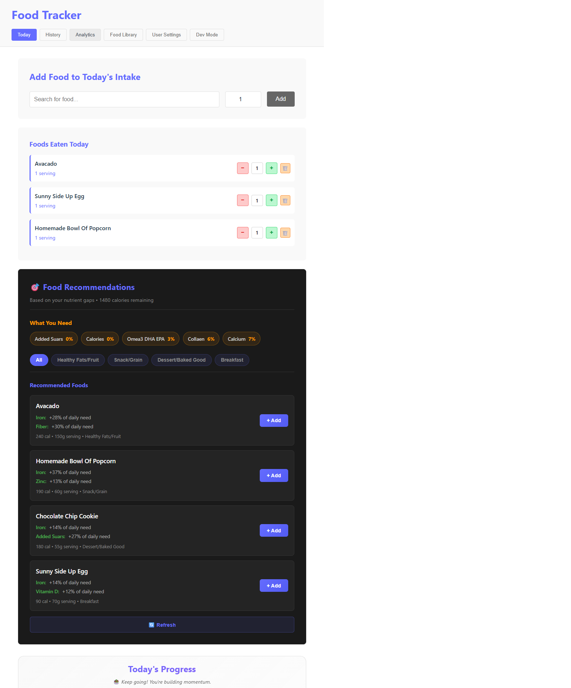
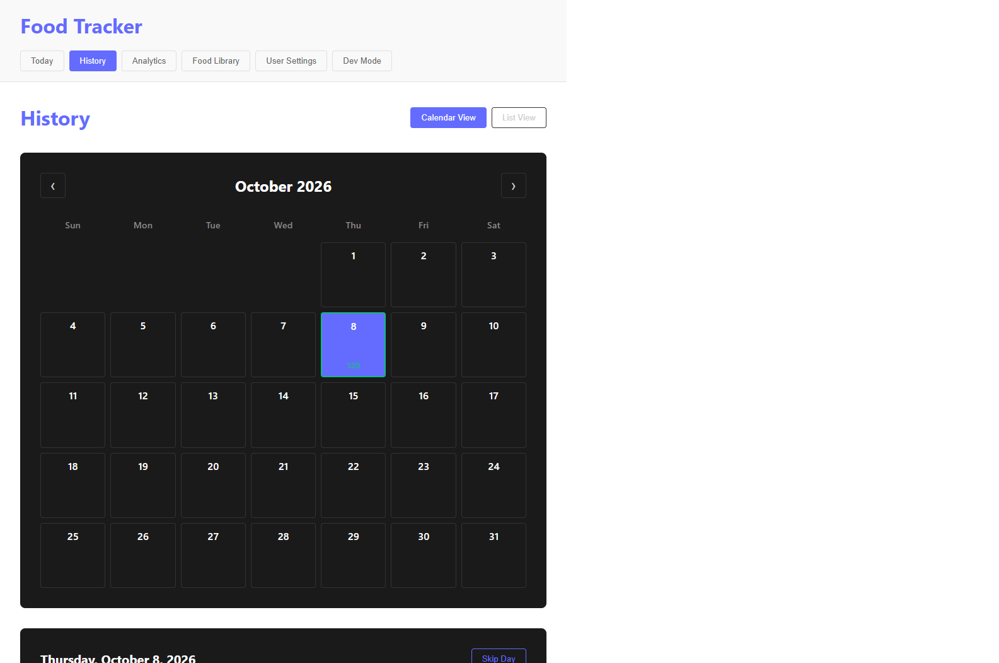
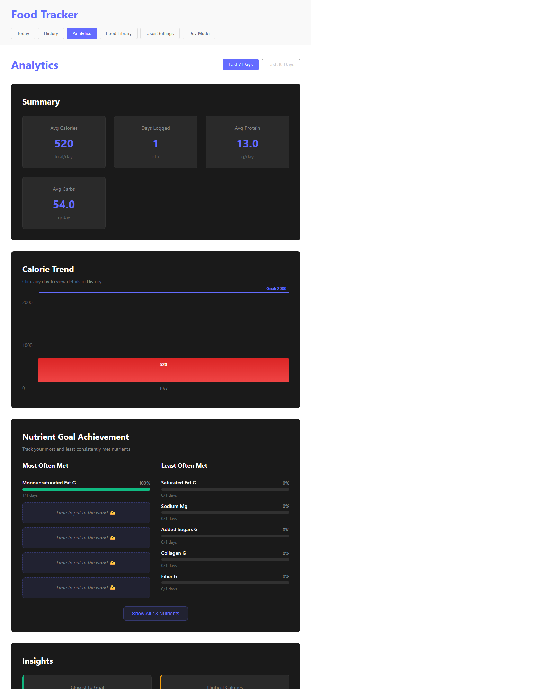
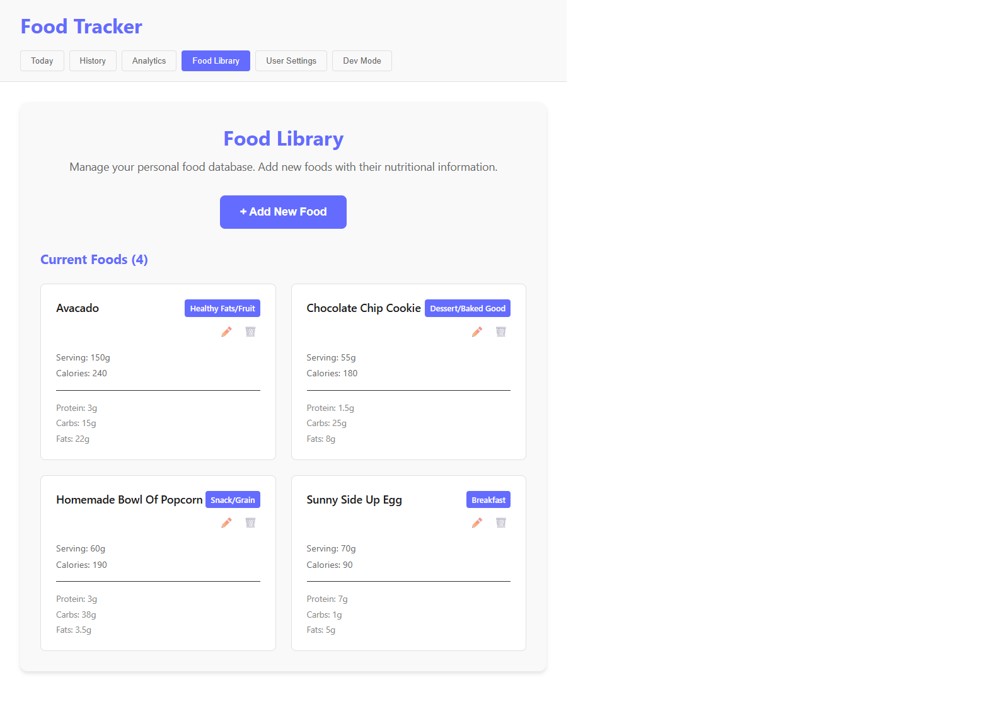
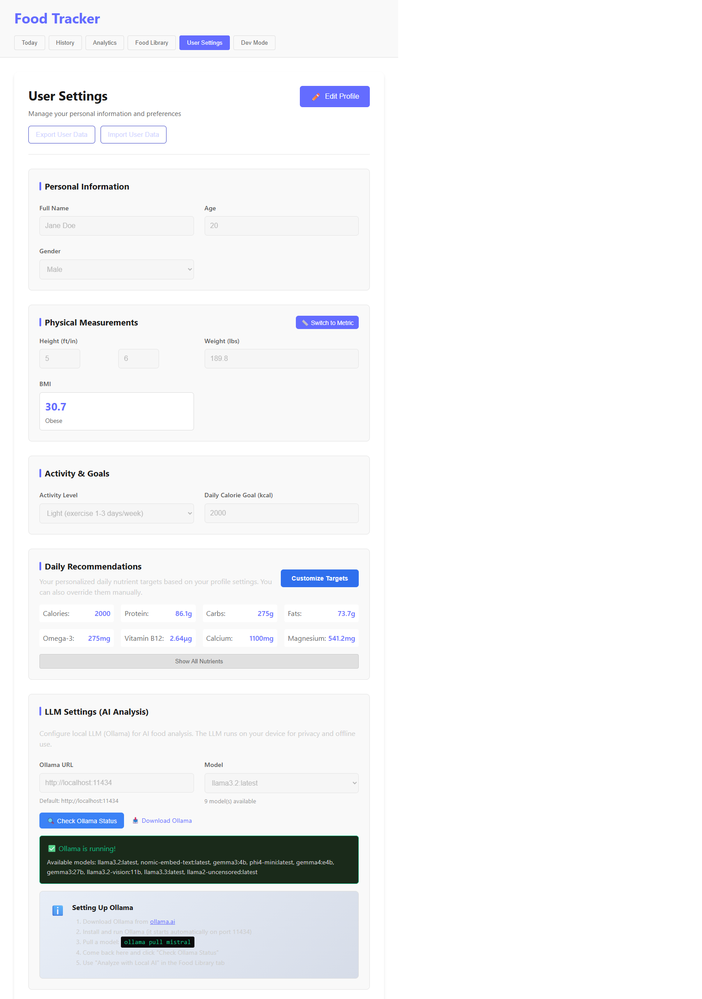

# Food Tracker

A full-stack nutrition tracking application that runs as a **Windows desktop app** or web application. Track your daily caloric intake, macronutrients, and meal history with an intuitive visual interface - all running completely offline on your computer.

## 🚀 Quick Start

### Want the Desktop App? (.exe)
**See [QUICK_START.md](QUICK_START.md)** for step-by-step instructions to build a Windows executable.

### Want to Run as Web App?
```bash
# Terminal 1: Start backend
cd server
npm start

# Terminal 2: Start frontend  
npm run dev
```

## 📚 Documentation

- **[QUICK_START.md](QUICK_START.md)** - Build your .exe in 5 steps
- **[ELECTRON_SETUP.md](ELECTRON_SETUP.md)** - Complete desktop app documentation
- **[BUILD_CHECKLIST.md](BUILD_CHECKLIST.md)** - Pre-build verification checklist
- **[ELECTRON_IMPLEMENTATION.md](ELECTRON_IMPLEMENTATION.md)** - Technical implementation details

## Demo

**Today** — log meals and track real-time progress toward your calorie and macro goals


**History** — browse past days on a calendar and drill into a day's food log


**Analytics** — trends across the last 7/30 days plus nutrient goal consistency


**Food Library** — manage a reusable database of foods with full nutrition info


**User Settings** — personalized goals, BMI, and optional local-AI (Ollama) configuration


## Overview

Food Tracker is a comprehensive nutrition management system that allows users to:
- Track daily food consumption with detailed nutritional breakdowns
- Visualize caloric and macronutrient data through interactive donut charts
- Manage a custom food library with nutritional information
- **Run as a native Windows desktop application**
- **Store all data locally (no internet required)**
- View historical data and analytics across multiple days
- Configure personalized caloric and macro goals

## Key Learnings

### State Management at Scale
- Mastered **React's useState and useEffect** hooks to manage complex, interconnected state across multiple tabs
- Implemented **prop drilling** and learned when component state should be lifted vs. kept local
- Handled real-time updates between frontend state and backend data persistence

### Full-Stack Data Flow
- Built a complete **RESTful API** with Express.js handling CRUD operations for food entries
- Learned to structure **modular backend code** with separate files for data management, calculations, and routes
- Implemented custom **nutrient calculation logic** to aggregate macros and calories from food entries

### UI/UX Design
- Created **responsive tab-based navigation** for organizing complex functionality
- Designed **interactive data visualizations** using donut charts to make nutritional data intuitive
- Implemented **form validation** and user feedback for food entry and goal setting

### Data Persistence Challenges
- Developed a **daily reset system** that archives previous day's data automatically
- Managed **historical records** with proper date tracking and retrieval
- Built a **food library system** allowing users to save and reuse common foods

## 🛠️ Technologies Used

### Frontend
- **React** - Component-based UI with hooks for state management
- **JavaScript (ES6+)** - Modern syntax and async operations
- **CSS3** - Custom styling with flexbox and grid layouts
- **Fetch API** - Asynchronous communication with backend

### Backend
- **Node.js** - JavaScript runtime for server-side code
- **Express.js** - Web framework for API routing and middleware
- **File System (fs)** - Data persistence using JSON files
- **CORS** - Cross-origin resource sharing middleware

### Tools & Libraries
- **Vite** - Fast development build tool
- **npm** - Package management
- **Nodemon** - Auto-restart server during development

## Future Enhancements

- [ ] Create WebApp for downloadable user experience
- [ ] Create mobile-responsive design for on-the-go tracking
- [ ] Integrate with nutritional local models to allow the user to use the app fully locally
- [ ] Deploy downloadable link to production

## 📦 Installation & Setup

```bash
# Clone the repository
git clone [repository-url]

# Navigate to FoodTracker directory
cd FoodTracker

# Install frontend dependencies
npm install

# Install backend dependencies
cd server
npm install

# Start the backend server (from server directory)
npm start

# In a new terminal, start the frontend (from FoodTracker root)
npm run dev
```

The app will be available at `http://localhost:5173` (frontend) and the API at `http://localhost:3001`.

## 📁 Project Structure

```
FoodTracker/
├── server/
│   ├── server.js              # Express server setup
│   ├── routes/
│   │   └── food.js            # API route handlers
│   └── data/
│       ├── foodLibrary.js     # Saved foods
│       ├── today.js           # Current day entries
│       ├── record.js          # Historical data
│       ├── user.js            # User goals/settings
│       ├── lastReset.js       # Reset tracking
│       └── nutrientCalculator.js  # Calculation logic
├── src/
│   ├── App.jsx                # Main app component with tab navigation
│   ├── components/
│   │   ├── TodayTab.jsx       # Daily tracking interface
│   │   ├── FoodLibraryTab.jsx # Food library management
│   │   ├── UserTab.jsx        # User settings
│   │   ├── CalorieDonut.jsx   # Calorie visualization
│   │   └── MacroDonuts.jsx    # Macro visualizations
│   └── style.css              # Global styles
└── index.html
```

---

Built to make nutrition tracking simple and visual.
